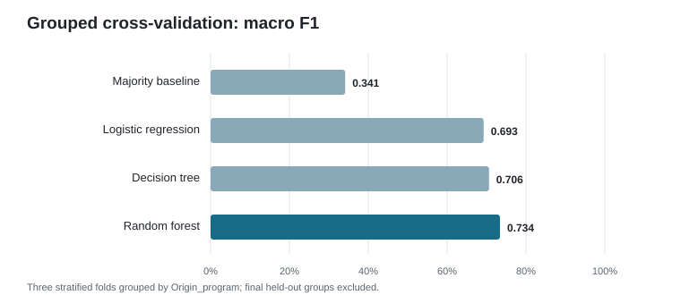
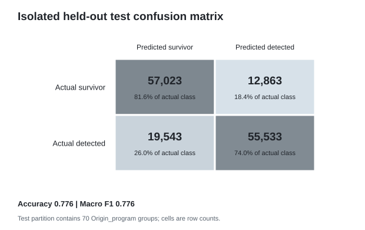

# QMutBench outcome prediction: grouped ML experiment

**Status:** bounded full-metadata training/evaluation completed on 2026-10-25. The 85% test-accuracy target was **not achieved**. This is an outcome-prediction experiment, not hardware diagnosis.

## Data audit and target

The selected source is the read-only public QMutBench metadata CSV `data/qmutbench_ingestion/raw/official_all_data_20261015.csv`, retrieved from the official endpoint and associated in the local source manifest with QMutBench repository commit `01f5e7700c051fe715fc368b307deaa7e6869ba8`. It is 59,913,911 bytes, SHA-256 `3f4547868673c583f047cee19d27c7bc97c64f15bb0586098ada778a3a0ff778`, and contains 723,079 rows, 12 columns, 375 `Origin_program` groups, 28 algorithms, 12 algorithm groups, and 2–30 qubits. The source repository is GPL-3.0; its cited commit was reported unsigned in the acquisition record. The official QMutBench paper describes 375 originals and 723,079 mutants ([paper](https://arxiv.org/abs/2604.15870), [repository](https://github.com/EnautMendi/QMutBench)).

There are no missing values. Full-row duplicates: 0. Duplicate rows ignoring source index and parent ID: 0. Repeated exact profiles across the registered seven model inputs: 0, including no profile crossing parent groups and no profile with conflicting labels. Near-identical circuit structures cannot be audited for most rows because the local QASM acquisition is only a 24-file, one-original-group subset; the CSV contains no mutant file path or mutant identifier. The complete metadata table is locally available; the complete source/mutant circuit corpus is not.

The raw `Killed` values are `WOO` (368,568), `OPO` (6,212), and `Survivor` (348,299). The prediction target is **recorded mutant detection by either oracle versus survival**: WOO and OPO map to detected (1), and Survivor maps to not detected (0). The original mutation-study definitions describe WOO as wrong-output detection, OPO as detection of a probability-distribution change using a chi-square test at significance level 0.01, and a mutant as surviving if neither oracle detects it ([primary study](https://link.springer.com/article/10.1007/s10664-025-10643-z)). This is a prediction of the historical benchmark outcome. It does not predict hardware noise, source-level localization, or behavior under the current simulator. OPO and WOO are combined only because both mean “detected” for this binary task; no three-class claim is made.

## Features and leakage controls

Registered input features, all available as circuit/mutation metadata before the recorded oracle outcome:

- Categorical: `algorithm`, `operation`, `gate`, `dominant_state`.
- Numeric: `qubits`, `gates`, `Position_int`.

`Killed` is the target and never enters the feature transformer. `Origin_program` is used only as the split group. `Unnamed: 0` is an acquisition row index. `algorithm_group` duplicates a coarser algorithm grouping and `position` bins `Position_int`; both are excluded. No simulator-derived observations or prior diagnosis fields are used. Mutation operator is intentionally an input because this task estimates historical detection outcome for a described mutation; the result must not be represented as inference from circuit behavior alone.

## Split and model comparison

Seed: `20261025`. A deterministic `StratifiedGroupKFold` partition holds out 70 whole `Origin_program` groups (144,962 rows); 305 groups (578,117 rows) are used for model selection and fitting. The train/test group intersection is empty. The remaining 305 development groups are evaluated with three stratified group folds. Preprocessing (median numeric imputation, categorical most-frequent imputation, one-hot encoding, and logistic scaling) is inside each sklearn pipeline and is fit on each fold's training partition only. No hyperparameter search or final-test threshold selection was performed. Candidate selection uses mean grouped-CV macro F1.

| Model | Mean group-CV accuracy | Mean balanced accuracy | Mean macro F1 |
|---|---:|---:|---:|
| Majority baseline | 51.84% | 50.00% | 34.14% |
| Logistic regression, class-weighted | 69.26% | 69.35% | 69.26% |
| Decision tree, fixed depth/leaf limits | 70.80% | 70.76% | 70.62% |
| Random forest, 40 trees, fixed depth/leaf limits | **73.41%** | **73.57%** | **73.40%** |

Random forest was selected by grouped-CV macro F1. A development-only random-row split scored 79.50% accuracy / 79.50% macro F1, but all 305 parent IDs appeared on both sides. It is a leakage-prone diagnostic, not validation evidence. The fixed group-held-out test is lower and has zero parent-ID overlap. The random and grouped estimates have different split composition and training sizes, so their difference is descriptive rather than a pure causal estimate of leakage.

The held-out group test accuracy is **77.65%**, balanced accuracy **77.78%**, and macro F1 **77.64%**. The 85% target was not met. Parent-group bootstrap 95% percentile intervals are 74.64–80.72% for accuracy, 74.83–80.68% for balanced accuracy, and 74.58–80.58% for macro F1 (1,000 resamples of the 70 test groups). These groups are `Origin_program` IDs; independent MQT recipe-root ancestry is unresolved, so this is not a verified unseen-recipe-family test.

| Actual \ predicted | Survivor | Detected (WOO/OPO) |
|---|---:|---:|
| Survivor | 57,023 | 12,863 |
| Detected (WOO/OPO) | 19,543 | 55,533 |

Held-out per-class metrics:

| Class | Support | Precision | Recall | F1 |
|---|---:|---:|---:|---:|
| Survivor | 69,886 | 74.48% | 81.59% | 77.87% |
| Detected (WOO/OPO) | 75,076 | 81.19% | 73.97% | 77.41% |

Mean unweighted per-`Origin_program` accuracy across the 70 held-out origins was 80.37% (median 82.13%, range 58.79–98.76%; 10th–90th percentiles 62.63–94.45%). It is descriptive and weights each parent equally, unlike the row-pooled headline metrics.





## Reproduction and artifacts

From the repository root with the existing environment:

```powershell
.\.venv\Scripts\python.exe -m experiments.qmutbench_outcome_ml_audit
.\.venv\Scripts\python.exe -m experiments.qmutbench_outcome_ml smoke --limit 30000 --output-dir data/qmutbench_ml/outcome_model_v1
.\.venv\Scripts\python.exe -m experiments.qmutbench_outcome_ml train --output-dir data/qmutbench_ml/outcome_model_v1 --cv-folds 3
.\.venv\Scripts\python.exe -m experiments.qmutbench_outcome_ml evaluate --output-dir data/qmutbench_ml/outcome_model_v1
.\.venv\Scripts\python.exe -m experiments.qmutbench_outcome_ml load-model --output-dir data/qmutbench_ml/outcome_model_v1
.\.venv\Scripts\python.exe -m experiments.qmutbench_outcome_ml predict --input path\to\new_metadata.csv --output data\qmutbench_ml\outcome_model_v1\predictions.csv --output-dir data\qmutbench_ml\outcome_model_v1
.\.venv\Scripts\python.exe -m experiments.render_qmutbench_outcome_ml_figures --metrics data/qmutbench_ml/outcome_model_v1/metrics.json --output-dir reports/experiments/qmutbench_outcome_ml
.\.venv\Scripts\python.exe -m pytest tests/test_qmutbench_outcome_ml.py -q
```

Grouped-CV fold summaries are cached under `data/qmutbench_ml/outcome_model_v1/cv_checkpoints`; matching completed folds are reused. The full model, held-out row predictions, and complete metrics manifest are stored under `data/qmutbench_ml/outcome_model_v1/`, which is git-ignored. The committed sanitized metrics snapshot is `metrics.json`; it records the source hash, split seed and group hashes, features, target, CV results, parameters, Python/pandas/NumPy/scikit-learn/joblib versions, test metrics, and model SHA-256 `5638e554328ba18b0f741e1af2fdcb78d58ea158419073e15b47fbf50c6141c7`. The model binary itself is not committed.

The bounded smoke test used 30,000 rows and 36 parent groups, completed a group-disjoint fit/evaluation, and checked deterministic joblib save/load prediction equality. It is a pipeline check, not a metric result. The full metadata training took approximately four minutes on this host; the category-coded dataframe used about 19.6 MB, and observed process working set samples were around 260–310 MB. Available physical memory before training was 2.67 GiB. No QASM simulation, full-corpus re-ingestion, IBM job, or added dependency was used.

## Limitations and next work

- QMutBench's 375 origins are not independently verified MQT recipe roots. The result establishes generalization to held-out origin identifiers only.
- The metadata outcome is from historical oracle evaluation, not independent behavioral adjudication. It cannot establish fault attribution or noise robustness.
- The public corpus metadata is complete locally, but QASM sources are not. The model intentionally predicts from metadata rather than claiming circuit-semantic understanding.
- A further study should hold out verified recipe families, compare richer circuit representations only after source-lineage acquisition, and pre-register a new test split. The current held-out split has already been inspected and must not be reused as a future confirmation set.
- Improving beyond 85% is future work. Do not tune against this final test or reinterpret the target.

## Selected-data resumable experiment

The original full-metadata result, model, frozen test definition, and metrics above are preserved as the baseline. A second experiment now selects complete `Origin_program` groups only from the original development partition. Its deterministic greedy selector rewards coverage of rare pre-outcome metadata values and rare `(algorithm, operation, gate, dominant_state, target)` combinations, while regularizing class prevalence and mildly penalizing oversized groups. Selection assignments retain every source record ID and identify frozen-test, selected-development, and unselected-development groups. The selector reads the source in bounded CSV chunks; it does not run the simulator.

Run or resume the selected experiment from the repository root:

```powershell
.\.venv\Scripts\python.exe -m experiments.qmutbench_selected_pipeline run --target-rows 50000 --chunk-rows 50000 --output-dir data/qmutbench_ml/selected_pilot_v2
.\.venv\Scripts\python.exe -m experiments.qmutbench_selected_pipeline status --output-dir data/qmutbench_ml/selected_pilot_v2
```

Every source range is saved as an atomic CSV chunk under the requested ignored output directory. The manifest records source hash, schema, selection seed/configuration, full source-row-to-group assignment, class counts, chunk hashes, and progress. Resume verifies checksums and reuses valid chunks; corrupted or missing chunks are rewritten. Training stages use a separate state file and checksum-verified model checkpoints for each grouped validation fold/candidate. The experiment key binds checkpoints to the source, selected groups, feature schema, seed, fold count, and candidates. Candidate choice uses only grouped validation; the final model is evaluated on the frozen test groups. All selected outputs and model artifacts remain git-ignored. This selected run is a separate evaluation and does not overwrite the full-data baseline artifacts.

### Completed selected-data run (2026-10-25)

The 50,000-row pilot selected 50,772 records from 43 complete development origins and produced weak grouped validation (Random Forest: 54.11% accuracy, 51.77% macro F1). That result justified expanding coverage. The pilot's Extra Trees label was initially wired to the Random Forest instance; its candidate comparison is invalid and is not used. The wiring is fixed and regression-tested in the runner.

The corrected expanded run selected **125,013 records from 86 development origins** (about 21.6% of the full source and 28.2% of the 305 development origins), using **15 verified chunks** with 50,000 source rows per scan range. Selection covered algorithm and algorithm-group categories, mutation operation/gate, dominant state, qubit count, gate-count bins, and mutation position, plus rare joint input/target profiles; it does not include any of the 70 frozen test origins. Three-fold group validation selected Extra Trees by macro F1:

| Candidate | Group CV accuracy | Balanced accuracy | Macro F1 |
|---|---:|---:|---:|
| Random Forest | 66.28% | 66.42% | 66.12% |
| Extra Trees | **67.92%** | **68.23%** | **67.70%** |

On the frozen test (70 origins, 144,962 rows, zero group overlap), the selected model achieved **73.49% accuracy**, 73.71% balanced accuracy, and 73.46% macro F1. Group-bootstrap 95% intervals were 70.55–76.29% for accuracy, 71.04–76.30% for balanced accuracy, and 70.53–76.15% for macro F1. Mean per-origin accuracy was 75.46% (median 74.42%, range 52.16–94.80%). Per-class F1 was 74.41% for Survivor and 72.50% for Detected. The original full-data baseline remains 77.65% on the same frozen test; the selected-data model is lower and **does not reach 85%**. There is no validation evidence that a still larger subset would help, so no subset beyond 125,013 rows was run. The frozen test was evaluated during the pilot and several implementation runs. One expanded comparison was invalidated because Extra Trees had been wired as Random Forest; a later selection-schema run chose the same groups and produced the same model and score. Test results did not guide group, feature, or model choices, but this repeated use means the selected-data score is exploratory, not an independent confirmatory estimate. The pilot's candidate comparison is invalidated.

The timed train stage reported **44.8 seconds**, including grouped validation, the selected-model fit, and its initial frozen-test prediction pass. The later 1,000-replicate bootstrap and group-wise summary are separate. Fold model-fit times were approximately 6.0–6.2 seconds per Extra Trees fold and 3.5–4.0 seconds per Random Forest fold. The Python process working set peaked around 229 MB during this run. The selected model and preprocessing pipeline, per-fold candidate checkpoints, manifest, verified chunks, metrics, and test predictions are under ignored `data/qmutbench_ml/selected_v3/`. Resume/status commands:

```powershell
.\.venv\Scripts\python.exe -m experiments.qmutbench_selected_pipeline run --target-rows 125000 --chunk-rows 50000 --output-dir data/qmutbench_ml/selected_v3
.\.venv\Scripts\python.exe -m experiments.qmutbench_selected_pipeline status --output-dir data/qmutbench_ml/selected_v3
```
