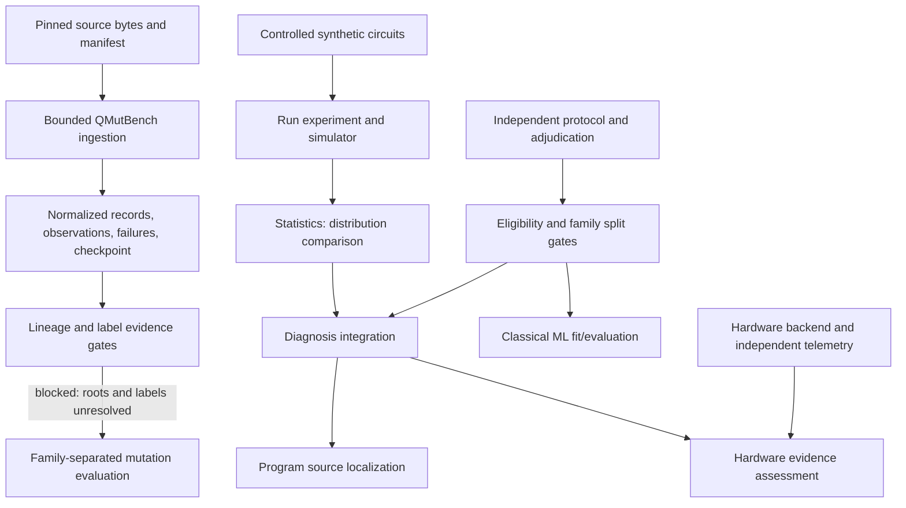

# Research Framework Architecture and Readiness

**Scope:** architecture/readiness inventory only. No full ingestion, model fitting, large experiment, physical-device run, or frozen-test change was made. Current QMutBench program-mutation eligibility remains **zero verified independent recipe roots**. The project’s three-way diagnosis endpoint remains a separate research task.

The source descriptions below were checked against the [pinned QMutBench repository](https://github.com/EnautMendi/QMutBench/tree/01f5e7700c051fe715fc368b307deaa7e6869ba8), its [README](https://github.com/EnautMendi/QMutBench/blob/01f5e7700c051fe715fc368b307deaa7e6869ba8/README.md), and official [MQT Bench documentation](https://mqt.readthedocs.io/projects/bench/en/stable/) and [repository](https://github.com/munich-quantum-toolkit/bench). These sources document dataset organization and generator capabilities; they do not establish per-origin QMutBench/MQT ancestry or independent labels. Local hashes and the exact gaps are preserved in `reports/experiments/qmutbench_external_evidence_manifest_20261015.json` and `reports/qmutbench_lineage_audit_20261015.json`.

## Dependency map



| Component | Inputs and outputs | Current use / dependency | Gap or boundary |
|---|---|---|---|
| Simulator and experiment runner: `src/quantum_simulator/`, `experiments/run_experiment.py` | Circuit operations, shots, seed, optional `HardwareModel` → execution counts/distributions and structured experiment result | Immediately usable on tiny deterministic/synthetic fixtures. `reports/experiment_schema.json` describes the established experiment-result shape. | Synthetic scenarios and `HardwareModel` simulations are not independent physical evidence. This output schema allows extra properties and has no single cross-pipeline run envelope. |
| Statistical anomaly comparison: `src/quantum_simulator/statistics.py::compare_distributions` / `compare_counts` | Expected/observed distributions or counts, threshold, shots → TVD, JSD, Hellinger, finite-shot guard, decision | Independently testable and reusable for null/effect simulations. | Current `max(threshold, 1/sqrt(shots))` rule is heuristic, not a calibrated hypothesis test. Frozen 45-case failure is evidence against claiming acceptance. |
| Program localization: `src/quantum_simulator/fault_localizer.py` | Reference/submitted operations and trace evidence → operation candidates | Existing diagnosis path; suitable for controlled software fixtures. | Requires source/reference information; candidate localization does not prove behavioral fault truth. |
| Hardware evidence: `src/quantum_simulator/hardware_fault_localizer.py`, `hardware_model.py`, diagnosis integration | Circuit, calibration/hardware model, trace and metadata → hardware candidates/evidence | Offline model fixtures only. | No live backend, device observations, trusted calibration provenance, or independent hardware labels. Do not combine with program-mutation evaluation. |
| Bounded QMutBench source path: `experiments/qmutbench_corpus_pipeline.py` | Pinned CSV and QASM source manifest, row range, shots/seed, output dir → normalized JSONL, simulator observations, failures, run/checkpoint manifests | Immediately usable for tiny source-verified subsets. Deterministic record IDs, code/config/source hashes, output offsets, atomic checkpoint writes, safe resume, max 12 qubits, explicit row limit, and streamed records are implemented and tested. | Local QASM coverage is 24 files / one origin group. Observations are simulator-derived; official parent grouping is not a root attestation. |
| Legacy QMutBench feature pipeline: `qmutbench_ml_pipeline.py` | Legacy/local metadata/QASM paths, selected rows, chunk/batch sizes → trace features and chunk outputs/checkpoints | Resume and chunk behavior can be exercised with mocks. Kept separate from the newer provenance-focused corpus pipeline. | Duplicates circuit extraction/simulation responsibilities, has a hardcoded legacy default source path, older label/feature conventions, and less complete provenance binding. Do not connect to a research fit until adapted and gated. |
| Evidence/eligibility: `experiments/diagnosis_lineage_inventory.py`, `experiments/diagnosis_evidence_gates.py`, `experiments/diagnosis_evaluation_protocol.py`, `qmutbench_evidence_readiness.py` | Inventories, hashes, partitions, labels/attestations, endpoint protocol → blockers/eligible records | Fail-closed structural checks; QMutBench evidence checker reports all seven gates blocked. | Structural validity cannot authenticate external truth. Current prior inventory is incomplete; source roots, labels, and review trust evidence are absent. |
| Classical ML: `ml_training.py`, `ml_evaluation.py`, `qmutbench_ml_pipeline.py`, `src/quantum_simulator/ml_diagnosis.py` | Feature table + labels → model/report; observable adapter consumes a fixed five-feature schema | Baseline model APIs and grouped evaluation implementations exist. Current pilot/preflight paths can assess schemas without fitting. | Historical QMutBench labels are original/mutant record types; controlled three-class records are synthetic. No eligible data supports new fitting. No validated production model artifact is available. |
| Frozen evaluation: `tests/test_reference_diagnosis_generalization.py`, fixture and root-cause report | Fixed 45 cases, labels, thresholds → acceptance outcome | Must remain read-only; forensic explanation test passes. | Acceptance test retains the same seven mismatches. Never tune on or use these cases for training, threshold selection, or method choice. |

## Contracts and orchestration

Current pipelines already have stage-specific contracts: the experiment JSON Schema, versioned QMutBench normalized/observation/failure records (`qmutbench-normalized-record-v1`, `qmutbench-simulated-observation-v1`, `qmutbench-rejection-v1`), versioned pilot/inventory records, protocol versions, and pipeline-specific checkpoints. The corpus checkpoint binds source/config/code hashes and output byte offsets; the older feature pipeline binds selected row indices and some chunk parameters. No artifact format was changed in this task.

There is no shared top-level run coordinator or common manifest adapter. That is an interface gap, but a general DAG/worker framework would be premature: the principal ingestion and ML routes duplicate work and have different evidence semantics, and model fitting is blocked. For the next authorized stage, retain the stage-specific files and bind them with a small *wrapper* manifest (schema version, parent artifact paths and SHA-256 values, stage ID, canonical config hash, code/runtime hashes, resource caps, status, checkpoint/output hashes). Add an adapter only when two concrete stages need to exchange artifacts. Never migrate historical JSON/CSV silently; keep legacy readers explicit and versioned.

The next bounded orchestration increment should be a dry-run stage planner that validates dependency hashes, resource caps, and evidence preconditions without executing stages. A future execution adapter must keep ingestion, observation generation, feature extraction, eligibility, fitting, and evaluation as distinct stages; allow resume only when parent hashes/config/code hashes match; and use create-only/atomic outputs. Worker count should remain one until deterministic parallel behavior is separately validated. The QMutBench eligibility and external-review gates must remain hard stops before fit/evaluation.

## Implemented readiness and remaining blockers

| Area | Ready on small fixtures | Still blocked for research claims |
|---|---|---|
| Statistical behavior | Distribution validation, metrics, seed-controlled simulation, finite-shot fixture/resume machinery | Null calibration and power operating characteristics for a prespecified endpoint/effect; current detector is heuristic. |
| Program mutation | Pinned metadata check, selected-QASM hash validation, bounded paired simulation, stable source-row IDs | Complete release artifacts, full origin→mutant→recipe-root ancestry, MQT ancestry, complete prior-inventory reconciliation, independent behavioral labels. Current count: 0 eligible roots. |
| Localization | Source and hardware candidate APIs tested independently and integrated behind evidence routing | Independently adjudicated targets and separately compatible observations for each endpoint. |
| Classical ML | Fixed observable feature interface, preflight, grouped evaluation machinery, mock/fixture tests | Independent roots/labels, preregistered sample/power plan, locked partitions, feature provenance, compatible dataset; no new fitting. |
| Hardware | Offline contracts and model fixtures | Separate authorization, live backend/session, immutable telemetry, calibration provenance and independent adjudication. |
| Publication evaluation | Reports and reproducibility artifacts exist | Independent source/label review, stable eligible frame, preregistered primary endpoint and uncertainty, external methods review, and the frozen acceptance blocker. Software tests alone do not establish publication readiness. |

## Go/no-go research roadmap

1. **Statistical characterization (first small experiment; simulator-independent synthetic distributions).** Before execution, preregister the comparison code hash, endpoint (two-sample observable-distribution anomaly), repetitions, analysis, and resource cap. Use a four-outcome reference distribution `p=(0.50, 0.25, 0.15, 0.10)`; draw independent reference/submitted multinomial counts at 256, 1,024, and 4,096 shots. Null: `q=p`. Fixed alternatives transfer mass from outcome 1 to outcome 2 by `delta ∈ {0.025, 0.05, 0.10, 0.20}` (`q=(0.50-delta, 0.25+delta, 0.15, 0.10)`, so TVD is exactly `delta`). Use 2,000 null replicates and 500 replicates per alternative/shot cell. Derive each stream seed as the first 32 bits of SHA-256 over UTF-8 `protocol_id|shot_count|condition_id|replicate_index|stream_role`, where stream role is `reference` or `submitted`; freeze `protocol_id` and condition IDs in the preregistration. Apply the existing TVD guard without retuning; report its false-positive rate and exact one-sided 95% binomial upper bound, plus sensitivity/power with two-sided 95% intervals by effect and shot count. **Null gate:** upper bound ≤0.06 at each shot count; otherwise report failure and stop. Alternative results are a power curve, not proof of a program fault or permission to tune against the frozen 45. Cap at 12,000 independent count-pairs (6,000 null + 6,000 alternative), one worker, 10 CPU minutes, and 256 MiB output/RAM budget; abort without changing the preregistration if a cap is reached. This is a statistical-method feasibility study, not QMutBench evaluation, family inference, or physical validation.
2. **QMutBench provenance acquisition.** Require all seven external evidence gates in `reports/experiments/qmutbench_external_evidence_manifest_20261015.json` to pass independent review; reconcile against a complete prior inventory. Until then remain at zero eligible roots and do not produce a family split.
3. **Controlled program-mutation detection.** Once independent labels and sufficient verified recipe roots exist, freeze detection-only endpoint, compatible measurement configuration, family-level sampling frame, split and minimum family/power plan. Keep source localization and hardware attribution out of this endpoint. Run a bounded pilot only after an approved protocol; stop on unresolved roots, label disagreement, or unsupported execution.
4. **Classical ML baseline.** Only after stage 3 evidence gate passes, fit a fixed majority/stratified dummy and one prespecified classical candidate on train roots; calibrate on distinct calibration roots; evaluate once on sealed test roots. Keep feature schema, leakage audit, model artifact metadata, threshold, uncertainty, and output manifest fixed. No QML dependency; reconsider QML only after a specific validated limitation and falsifiable QML hypothesis.
5. **Source localization and hardware attribution.** Treat as separate endpoints with their own independent truth, evidence protocol, sample plan, and acceptance criteria. Hardware stage additionally requires authorization, backend/session metadata, raw device observations, and independent calibration/condition provenance.
6. **Publication evaluation.** Only after the relevant endpoint passes its evidence and statistical gates: independent protocol/methods review, complete reproducibility bundle, limitations, resource accounting, and a transparent account of the frozen 45-case failure. No claim of publication readiness follows from this architecture report.

## Validation record

The status file contains an older legacy 89-pass snapshot and a later finalization snapshot of 794 passed / 1 failed; neither was rewritten. The current commands/results below supersede those counts for this architecture-readiness pass.

Focused architecture-related suite command covered QMutBench corpus pipeline, resumable legacy chunk processing, ML preflight, diagnosis evidence gates/protocol, finite-shot resume, and the frozen forensic explanation test:

```powershell
.\.venv\Scripts\python.exe -m pytest tests\test_qmutbench_corpus_pipeline.py tests\test_qmutbench_ml_pipeline_resume.py tests\test_ml_preflight.py tests\test_diagnosis_evidence_gates.py tests\test_diagnosis_evaluation_protocol.py tests\test_finite_shot_calibration_resume.py tests\test_reference_diagnosis_generalization.py::test_frozen_heldout_mismatches_are_explained_by_distribution_resolution -q --tb=short --basetemp .t-research-architecture-focus-20261015
# 81 passed
```

Bounded suite used a fresh workspace-local basetemp with both registered finite-shot exclusions retained:

```powershell
.\.venv\Scripts\python.exe -m pytest tests -q --tb=short -k "not bounded_recipe_comparison_120_templates_and_finite_shot_subset and not independent_calibration_fixture_and_permutation_comparison" --basetemp .t-research-architecture-bounded-20261015
# 812 passed, 1 failed, 2 deselected
```

The sole failure is `tests/test_reference_diagnosis_generalization.py::test_heldout_generalization_outcomes_and_targets`; its same seven frozen outcomes mismatch. The fixture, labels, thresholds, and outcomes were not changed. No model training, full ingestion, large benchmark, or hardware work was run.
